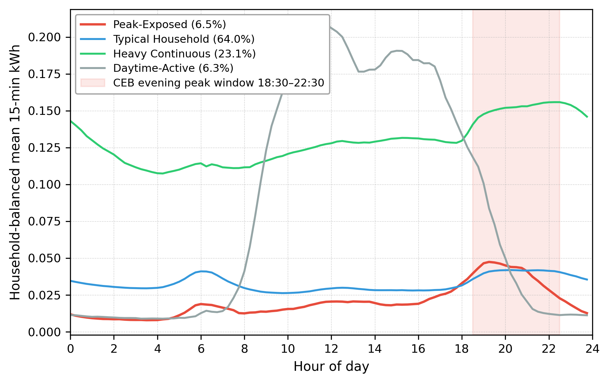
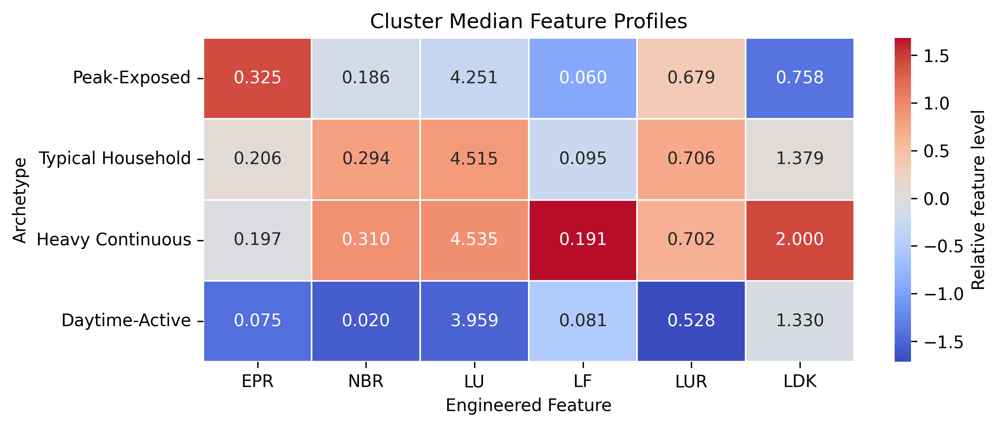

# Temporal Electricity-Use Patterns in Sri Lankan Households

**A data-driven approach for characterizing and segmenting temporal electricity-use patterns in Sri Lankan households using high-frequency smart-meter data**

Undergraduate data science research | NSBM Green University, Sri Lanka | 2026

> **Repository status:** Curated research portfolio draft. The notebooks and Streamlit applications are included for methodological inspection, **not** as a fully reproducible or independently tested deployment. Restricted datasets and executable trained-model artifacts are not included.

## Research question

Monthly electricity totals show how much energy a household uses, but not *when* it uses that energy. This research asks whether high-frequency smart-meter observations can identify interpretable, household-level electricity-use patterns in a Sri Lankan residential sample, and how those patterns can be assessed against other available evidence.

The main analysis uses the **LIRNEasia Sri Lankan Residential Electricity Consumption Dataset**. The retained clustering cohort comprises **2,227 households**, observed within **May–November 2024** after the study's eligibility and quality checks.

## Research approach

1. **Prepare the 15-minute smart-meter records:** apply data-quality controls, define the eligible analysis window, and construct household-level summaries.
2. **Engineer six behavioral features:** evening peak ratio, night baseload ratio, load uniformity, load factor, leisure-usage ratio, and log daily electricity consumption.
3. **Segment households:** standardize the features and evaluate K-Means candidate solutions. Select **K = 4** as the smallest interpretable solution preserving the distinct patterns of interest, rather than claiming it maximizes every internal metric.
4. **Evaluate reliability:** examine internal cluster validity, random-seed and bootstrap stability, alternative approaches, and temporal reassignment.
5. **Assess contextual consistency:** examine monthly billing, household survey information, and six-hour cumulative-register evidence as supporting sources, without treating them as ground-truth cluster labels.

For detailed research steps and validation boundaries, see [Methodology](METHODOLOGY.md).

## Main findings

| Behavioral archetype | Households | Share of retained sample | Interpretation |
| --- | ---: | ---: | --- |
| Peak-Exposed | 145 | 6.5% | Concentrated evening usage |
| Typical Household | 1,426 | 64.0% | Common mixed daily-use profile |
| Heavy Continuous | 515 | 23.1% | Higher, more sustained usage |
| Daytime-Active | 141 | 6.3% | Greater relative daytime activity |

**Primary clustering evaluation (2,227 households):**

| Measure | Result | Interpretation |
| --- | ---: | --- |
| Silhouette score | 0.251 | Moderate internal separation |
| Mean random-seed adjusted Rand index (ARI) | 0.992 | Very similar assignments across tested initializations |
| Mean bootstrap ARI | 0.715 | Some sensitivity to the sampled households |
| Dominant monthly-state retention | 87.5% | Considerable temporal persistence in the studied window |

These are **sample-specific behavioral archetypes**, not nationally validated household categories. The groups describe observed patterns rather than causes of electricity use.

### Visual summaries





The heatmap summarizes cluster feature profiles; the daily curves represent aggregated patterns rather than individual households.

## Supplementary analyses

The following studies complement the primary unsupervised clustering. They have **different targets, validation designs, and sample sizes**; their scores should not be compared as though they estimate the same task.

| Analysis | Scope | Selected result and evaluation basis |
| --- | --- | --- |
| Billing-to-archetype transfer | 1,146 billing-matched households; four smart-meter-derived pseudo-labels | Balanced accuracy **0.5226**, macro-F1 **0.4727** for the *adaptive nested out-of-fold procedure*. These are not independent performance estimates for the exact final fitted prototype. |
| Survey-based high-consumption profiling | 1,413 households; high use defined relative to the study sample | Logistic Regression: ROC-AUC **0.8207**, average precision **0.7194** from nested out-of-fold evaluation. |
| Electricity-related operational CO₂ regression | 1,656 eligible households; constant factor **0.71 kg CO₂/kWh** | Histogram Gradient Boosting: held-out **R² = 0.3974**, **MAE = 46.26 kg CO₂/month**. |
| Study-relative high-emission classification | Same primary carbon-qualified cohort; class defined by a development-data percentile | Random Forest: held-out average precision **0.5114**, ROC-AUC **0.7516**, balanced accuracy **0.6898**. |

The carbon outcome is **estimated operational CO₂ associated with imported grid electricity**, not a household's full carbon footprint or a time-varying marginal emissions estimate. These models do **not** establish causal effects, predict future emissions, or supply a national classification standard.

For model-specific definitions and limitations, see the documentation in [`models/`](models/), including:

- [Billing-to-archetype model card](models/BILLING_ARCHETYPE_MODEL_CARD.md)
- [High-consumption model card](models/PHASE3_final_model_card.md)
- [Carbon/XAI model card](models/FINAL_MODEL_CARD.md)

## Repository contents

```text
.
├── app/
│   ├── SmartMeter_Insights_App_Clean_Draft.py
│   └── SmartMeter_Model_App_Clean_Draft.py
├── figures/
│   ├── cluster_feature_heatmap.png
│   └── fig_load_profiles_color.png
├── models/                  # Three model cards and three metadata files; no trained binaries
├── notebooks/               # Ten source drafts; sensitive or unsafe workflows withheld
├── results/                 # Four aggregate research/result tables
├── .gitignore               # Conservative exclusions; not a substitute for a security audit
├── METHODOLOGY.md           # Main analytical procedure and validation design
├── RESULTS.md               # Recorded aggregate results and interpretation
├── DATA.md                  # Data provenance, access, and redistribution limits
├── REPRODUCIBILITY.md       # Execution, privacy, and replication boundaries
├── requirements.txt         # Unlocked dependencies for the two Streamlit applications
└── README.md
```

### Research code

The main workflow is in [`SmartMeter_Master_Pipeline_Public_Review_Draft.ipynb`](notebooks/SmartMeter_Master_Pipeline_Public_Review_Draft.ipynb). The [`Survey Validation public-review draft`](notebooks/SmartMeter_Survey_Validation_Public_Review_Draft.ipynb) is also included. Optional household-specific diagnostic cells were withheld or redacted in these two public-review drafts. The complete original notebooks remain in the separate private source project; the earlier cleaned draft copies are kept outside this repository for private review. The other included notebooks document K-selection, monthly/six-hour checks, clustering robustness, contextual analysis, billing-to-archetype transfer, and supplementary carbon/XAI modeling. The EDA notebook and survey-based high-consumption analysis notebook have been **withheld from this public draft pending a review of their file-deletion and output-replacement operations**; model documentation remains available under `models/`. The ten included notebooks have their stored execution outputs cleared; **that does not mean they have been safely or successfully rerun**. Some code still requires private inputs and may generate household-level exports.

### Results

A consolidated comparison of the verified primary and supplementary results is available in [Results and Evidence Boundaries](RESULTS.md).

- [Monthly behavioral-feature medians](results/monthly_feature_medians_by_locked_cluster.csv)
- [Monthly trend tests with FDR correction](results/monthly_feature_trend_tests_FDR_corrected.csv)
- [Carbon regression held-out metrics](results/21_primary_continuous_emission_regression_heldout_test_metrics.csv)
- [High-emission classification held-out metrics](results/22_secondary_high_emission_classification_heldout_test_metrics.csv)

The monthly trend-test table records exploratory tests; **none of its 24 tests is marked significant after the recorded FDR correction**.

## Data availability and reproducibility

Raw smart-meter, monthly billing, six-hour register, and household survey records are **not redistributed** in this repository. Some notebook cells still refer to local project paths, private input files, or household-level outputs; certain cells may modify intermediate files if run. The applications also depend on research artifacts that are not included here.

**Consequently, this repository is not currently a run-from-scratch package.** No application launch instructions are provided until its dependencies, public-data boundaries, environment, and safe failure behavior have been independently verified. Please do not execute notebooks against private datasets without reviewing the relevant file operations and permissions.

The included aggregate tables and figures illustrate recorded results; they do not replace restricted input data or provide an independently reproducible environment. See [Reproducibility and execution boundaries](REPRODUCIBILITY.md).

## Responsible interpretation

- Archetype labels are study-specific, not externally verified ground truth or fixed categories for all Sri Lankan households.
- Billing-only transfer learns labels assigned by the smart-meter clustering workflow; it does not recover observed time-of-use behavior directly.
- High consumption and high emission are **study-relative** targets, not official tariff, welfare, poverty, or national emissions classifications.
- Supplementary explainability results characterize fitted models, not causal drivers.
- Neither application is represented here as production-ready, deployed, externally validated, or safe for individual decision-making.

## Attribution, publication, and reuse

This portfolio documents work undertaken for an undergraduate data science thesis at **NSBM Green University (October 2026)**. Its principal data source is the **LIRNEasia Sri Lankan Residential Electricity Consumption Dataset**. The repository does not grant permission to redistribute the original dataset or related confidential household records.

A canonical thesis/publication link, formal citation metadata, software licence, and any additional third-party reuse permissions should be added only after their details and publication rights are confirmed. **No open-source licence is currently assigned in this draft; public visibility does not automatically grant permission for reuse.**
